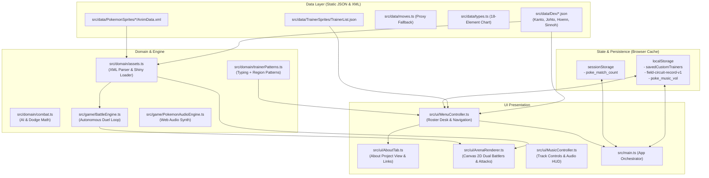

# Poké Battle (Field Circuit)

> **A fast, lightweight, browser-based Pokémon battle simulator and team builder built with modern TypeScript and Vite.**  
> Features autonomous 6-on-6 Pokémon duels, authentic 32-bit chiptune audio synthesizers, customizable trainer rosters, shiny mechanics, dynamic dodge physics, local persistence, and real-time canvas rendering.

---

## 📖 About Poké Battle

### Non-Commercial & Fan-Made Tribute
**Poké Battle** is a strictly **non-commercial** and **non-profitable** open-source software project. It is crafted purely out of admiration, nostalgia, and artistic tribute to the Pokémon franchise. There is **zero monetization**, no advertisements, no microtransactions, and no paywalls.

### Project Inspiration
This project is directly inspired by the brilliant **Pokémon Battleground** videos. Huge respect and credit go to their creators for pioneering the concept of real-time, automated Pokémon arena clashes.
- 🌐 Visit their official site and watch their matches at: **[pokemonbattlegrounds.com](https://pokemonbattlegrounds.com)**

### Developer's Note
> *This game was developed by a single creator. I've always planned a game where the pokemon would fight, without turns, only the moves and then i watched the Pokémon Battleground videos and i decided to work on it, an automated, real-time fighting Pokémon game in the browser. The goal was to build a fluid experience where creatures dynamically maneuver with stats based orbits, execute physical dashes and ranged projectiles, dodge incoming attacks, in a all client-side without any downloads or server dependencies.*

### Continuous Updates & Community Collaboration
This web application is in active, continuous development! New Pokémon, balance adjustments, shiny mechanics, sound improvements, and arena themes are being added regularly.

Because this is a **100% open-source project**, the community is warmly invited to participate! Whether you would like to contribute new Pokémon sprites, enhance combat math, fix bugs, or build new features, your contributions are welcome:
- 🔗 **GitHub Repository**: [The full project here](https://github.com/GFV-dev/Poke-Battle)
- 🤝 **Pull Requests (PRs)** and issues are openly reviewed and appreciated.

---

## 🌟 Key Features

### ⚔️ Autonomous 6v6 Real-Time Battle Engine
- **Autonomous Tactical Duel**: Two teams of 6 Pokémon battle in real-time with speed-driven orbit physics, melee dashes, knockback effects, and elemental type matchups across 18 Pokémon types.
- **Dynamic Dodge System**: Dodge chances are calculated dynamically from each Pokémon's base Speed stat using the formula:
  $$\text{Dodge Chance} = 25\% \times \left(\frac{\text{Pokemon Speed}}{100}\right)$$
  *(e.g., 130 Speed = 32.5% dodge chance; 30 Speed = 7.5% dodge chance).*
  Dodges trigger an italic white floating indicator with an outline, styled 20% smaller than standard damage numbers.
- **Dynamic Speed & Range Calculation**: Faster Pokémon close gaps quickly and maintain optimal distance based on their moveset categories (melee punches, lunges, ranged bursts, projectiles).
- **Entrance Sequence**: Trainers walk to their marks (`TRAINER_ARRIVAL_MS`, 1.8 s); only then do their Pokémon spawn with a summon effect, and the match starts when the entrance ends (`ENTRANCE_DURATION_MS`, 2.4 s).
- **Arena Bounds**: Engine coordinates share the renderer's 1000×560 world (`src/game/arena.ts`). Every movement, dash, and knockback is clamped so Pokémon can never leave the court.

### ✨ Shiny Pokémon Mechanic
- **1/15 (15%) Natural Roll**: During Pokémon initialization and Dex loading, each Pokémon has a 1/15 chance to roll as a Shiny Pokémon.
- **Dedicated Data Models**: Tracked via `isShiny: boolean` on the `Pokemon` class, `PokemonDefinition`, and active `Battler` entities.
- **Dynamic Asset Nomenclature**: The asset pipeline automatically checks `isShiny` and appends `_shiny` to the filename nomenclature (`Walk-Anim_shiny.png`, `Portrait_shiny.png`, etc.), with automated fallback to standard sprites if custom shiny art is not yet present on disk.

### 🎨 PMD Collab Dynamic XML Asset Pipeline
- **Zero Hardcoding**: All hardcoded Pokémon configurations and exceptions have been eliminated in favor of an automated pipeline.
- **Automated XML Parsing**: Reads each Pokémon's `AnimData.xml` through Vite globs (`import.meta.glob`) and parses it with `fast-xml-parser`. `FrameWidth`, `FrameHeight`, and every `Duration` are cast to positive numbers, and `<CopyOf>` chains are resolved recursively so referenced animations inherit their dimensions and timings.
- **Strict Fallback Guarantee**: If `AnimData.xml` is missing or fails to parse, the system falls back to `DEFAULT_POKEMON_ANIM_CONFIG`. Known Pokémon never use fixed sizes; the renderer crops frames from the XML dimensions and clamps every source rectangle to the loaded image.
- **Ground Anchoring & Facing**: The renderer measures each Pokémon's foot position once from its Walk sheet and applies it to every animation, so creatures stay planted on the ground. Pokémon always face their opponent (left/right); if a sheet has no left row, the right row is mirrored.

### 🎴 Dynamic Typing + Region Background Patterns
- **Name-Free Categorization**: Removed all character-name dependencies. Patterns are derived strictly from the trainer's dominant Pokémon `Typing` and their home `Region`.
- **Unique Combinations**: Every typing + region pair generates a unique visual background texture (e.g., Fire + Kanto vs. Fire + Hoenn have distinct SVG patterns in `menu.css`).

### 🛠️ Custom Trainer Builder & LocalStorage Persistence
- **Interactive Team Builder**: Customize trainer name, visual avatar/shape, and select 6 custom Pokémon from any region.
- **Drag-and-Drop Reordering**: Drag Pokémon cards to reorder bench priorities in real time with visual ghost drag previews.
- **Local Persistence**: Save multiple custom trainers directly to browser `localStorage` (`savedCustomTrainers`), with one-click editing, deletion, and lineup inspection.

### 🖥️ Modern Combat Screen & Layout
- **Mirrored Arena Layout**:
  - **Left Side**: Trainer Icon $\rightarrow$ Stats/Vitals $\rightarrow$ Active Pokémon Icon $\rightarrow$ Central Clock.
  - **Right Side**: Central Clock $\rightarrow$ Active Pokémon Icon $\rightarrow$ Stats/Vitals $\rightarrow$ Trainer Icon.
- **Dynamic Centered Arena Header**: Displays `Arena: {ArenaTheme.Name} {ArenaTheme.WeatherIcon}` directly above the elapsed combat timer.
- **Decluttered Vertically Scrollable Combat Log**: Cleaned up log container with `overflow-y` scrolling for reviewing complete battle action history under **Action Field Calls**.
- **32-Bit Web Audio Synthesizer**: Authentic chiptune music engine (FireRed, Emerald, Diamond, Pearl themes) with randomized track selection, persistent volume memory (`poke_music_vol`), and floating audio dock.

### 🌐 Localization (English / Português)
- A flag dropdown in the header switches the UI between **English** (default) and **Portuguese (Brazil)** instantly.
- Dictionaries live in `src/utils/`: `language-en.ts` (source of truth, defines every key), `language-pt.ts` (typed so a missing key fails `tsc`) and `i18n.ts` (`t(key, params)`, `setLanguage`, `applyTranslations`). Portuguese is loaded lazily on first selection.
- Static markup uses `data-i18n` / `data-i18n-aria`; dynamic strings call `t('key', { n })`. Pokémon, move, trainer and type names are data and are not translated. The language choice is not persisted.
- To add a language: create `language-xx.ts`, register it in `i18n.ts` (`LANGUAGES` and `loaders`) and add a flag.

---

## 🏗️ Architecture Overview



### 1. Frontend-Only (No Server Required)
This project is **100% client-side**. There are no backend APIs, databases, or cloud servers:
- **Game Loop**: Runs at up to 60fps inside `requestAnimationFrame`, updating `BattleEngine` and drawing on HTML5 Canvas via `ArenaRenderer`.
- **Match State**: Completely held in memory during the match.
- **Persistence**: Managed through the browser's native `localStorage` and `sessionStorage`.

### 2. JSON & XML as the Game Database
All game data is statically declared and bundled using Vite:
- **`src/data/Dex/*_pokemons.json`**: Base stats (`hp`, `attack`, `defense`, `specialAttack`, `specialDefense`, `speed`), elemental typings, and move pools.
- **`src/data/TrainerSprites/TrainerList.json`**: Pre-configured trainers, lineups, regional themes, and titles.
- **`src/data/PokemonSprites/*/AnimData.xml`**: Sprite sheet frame data directly extracted from PMD SpriteCollab standards.
- **`src/data/moves.ts`**: Explicit move definitions backed by an intelligent `Proxy` generator that infers attributes for newly added moves.

### 3. Multi-Layer Caching Architecture
- **In-Memory Image Cache**: `ArenaRenderer` maintains an internal `imageCache` (`Map<string, HTMLImageElement>`) to prevent duplicate image allocations during 60fps renders, plus a `footOffsetCache` for measured ground anchors.
- **Asset Lookup Index**: `assets.ts` builds a case-insensitive index of each Vite glob map once, so sprite/portrait path resolution is O(1) per frame instead of a linear scan.
- **Parsed XML Cache**: `assets.ts` caches parsed `PokemonAssetConfig` objects in `parsedConfigCache` so XML strings are parsed at most once per Pokémon.
- **Cached Canvas Size**: `ArenaRenderer` tracks the canvas size with a `ResizeObserver` rather than reading layout every frame.
- **LocalStorage Cache**: Custom trainer designs, audio volume preferences, and career records persist across sessions.

---

## 🚀 Getting Started

### Prerequisites
- **Node.js**: v20.0.0 or higher (v22+ recommended)
- **npm**: v10.0.0 or higher

### Installation

1. Clone the repository:
   ```bash
   git clone https://github.com/GFV-dev/Poke-Battle.git
   cd PokeBattle
   ```

2. Install dependencies:
   ```bash
   npm install
   ```

3. Start development server:
   ```bash
   npm run dev
   ```
   Open `http://localhost:5173` in your browser.

---

## 🧪 Testing & Verification

The project includes unit tests covering combat rules, damage calculation, dodge chance formulas, shiny mechanics, XML parsing, trainer patterns, and content integrity using Node.js's built-in test runner:

```bash
# Run all test suites
npm test

# Run TypeScript compilation and production bundle build
npm run build
```

**Test-only creatures:** the legacy mock creatures (Cinderkit, Bramblet, Brawlkin, Flintbit, Fawndle) live exclusively in `tests/fixtures/fakemon.mjs`. A test file that needs them imports that module, which registers them in the in-memory `POKEMONS` registry for that test process only. They are not part of the shipped data, so they never appear in menus, rosters, or the arena.

---

## 🤝 Open-Source Contributor Guide

We warmly welcome Pull Requests! Here is how you can easily extend the game:

### 1. Adding a New Pokémon
1. Open or create the appropriate region JSON file in `src/data/Dex/` (e.g. `src/data/Dex/sinnoh_pokemons.json`).
2. Add the Pokémon's stats, size, types, and 4 moves:
   ```json
   "lucario": {
     "id": "lucario",
     "name": "Lucario",
     "size": 1.2,
     "type": "Fighting",
     "secondaryType": "Steel",
     "stats": { "hp": 140, "speed": 90, "defense": 70, "attack": 110, "specialDefense": 70, "specialAttack": 115 },
     "moves": ["aura-sphere", "close-combat", "extreme-speed", "swords-dance"]
   }
   ```
3. Create a folder in `src/data/PokemonSprites/Lucario/` containing:
   - `Portrait.png` (for Main Menu)
   - `Walk-Anim.png`, `Attack-Anim.png`, `Faint-Anim.png`
   - `AnimData.xml` (PMD SpriteCollab animation metadata)
   - *(Optional)* Shiny variants: `Walk-Anim_shiny.png`, `Portrait_shiny.png`
4. The game will automatically detect and integrate your Pokémon through Vite dynamic globs!

### 2. Adding a New Trainer
1. Add an entry to `src/data/TrainerSprites/TrainerList.json` with a 6-Pokémon roster and region.
2. Run `node scripts/create-folders.mjs`: it reads the `Name` fields from `TrainerList.json` and creates each `src/data/TrainerSprites/<TrainerName>/` folder (plus Pokémon sprite folders from the Dex files). No names are hardcoded.
3. Drop `Portrait.png` into the new folder.
4. Background patterns are dynamically generated based on dominant typing and region without touching code!

### 3. Submitting a Pull Request
1. Fork the repo and create your feature branch: `git checkout -b feature/new-pokemon`.
2. Make your changes adhering to TypeScript types.
3. Verify tests and build pass:
   ```bash
   npm test
   npm run build
   ```
4. Push your branch and open a Pull Request at [github.com/GFV-dev/Poke-Battle](https://github.com/GFV-dev/Poke-Battle).

---

## ⚖️ Legal Disclaimer

*Pokémon* and all related names, characters, sprites, and assets are trademarks & copyright of **Nintendo**, **Game Freak**, and **Creatures Inc.** (1996–2026).  
This project is an unofficial, non-profit, fan-made tribute built strictly for entertainment and educational purposes. It is not affiliated with, endorsed by, or sponsored by Nintendo or The Pokémon Company.  
Sprite animations are provided by the [PMD SpriteCollab](https://sprites.pmdcollab.org/) project, licensed under [CC BY-NC 4.0](https://creativecommons.org/licenses/by-nc/4.0/).